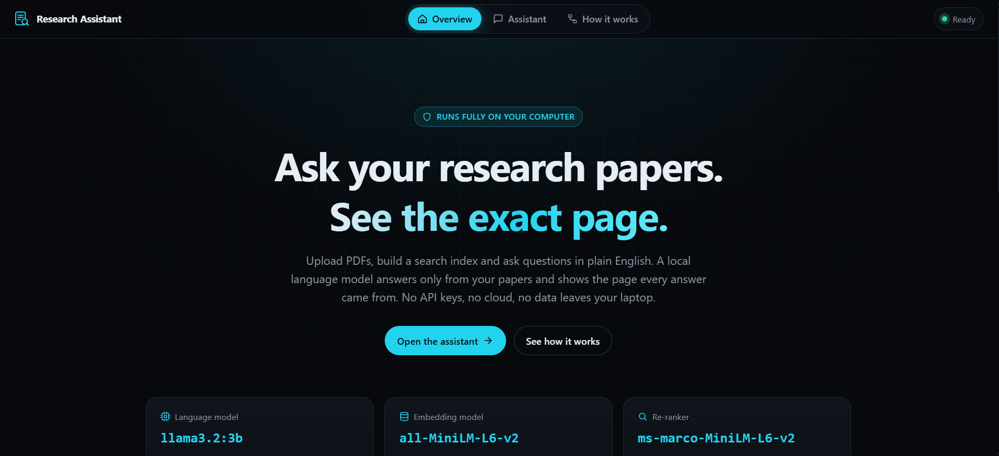
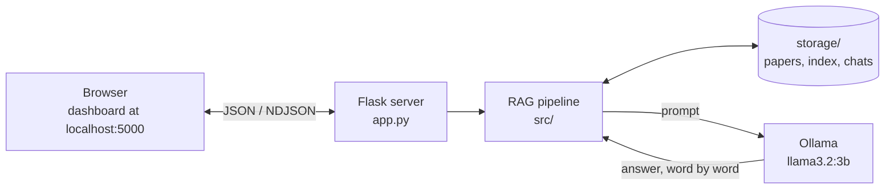
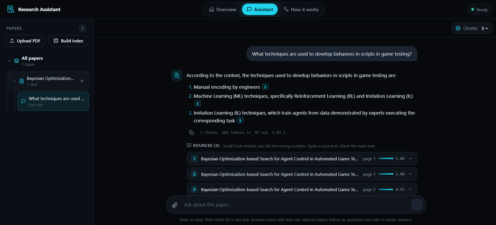
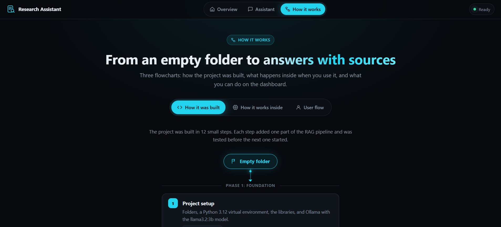

# Academic Research Assistant

[](https://github.com/TanmaySingh2711/academic-research-assistant/actions/workflows/ci.yml)

Ask questions about your research paper PDFs and get answers that point to the exact page they came from, all running on your own computer.



## Table of Contents

- [Overview](#overview)
- [The Problem](#the-problem)
- [Goals](#goals)
- [Key Features](#key-features)
- [Tech Stack](#tech-stack)
- [Architecture](#architecture)
- [How It Works](#how-it-works)
- [Project Structure](#project-structure)
- [Requirements](#requirements)
- [Installation](#installation)
- [Configuration](#configuration)
- [How to Run](#how-to-run)
- [Usage](#usage)
- [Example Output](#example-output)
- [Screenshots](#screenshots)
- [API](#api)
- [Models](#models)
- [Evaluation Data](#evaluation-data)
- [Results](#results)
- [Running the Tests](#running-the-tests)
- [Limitations](#limitations)
- [Contributing](#contributing)
- [License](#license)
- [Author](#author)
- [Acknowledgements](#acknowledgements)

## Overview

Academic Research Assistant is a local web app for reading research papers faster.

You upload PDFs, click **Build index**, pick a paper and ask a question in plain English. The app finds the parts of the paper that answer it and a local language model writes a short answer from only that text. Every answer lists its sources (paper and page), so you can open the exact paragraph and check it yourself.

This approach is called RAG (Retrieval-Augmented Generation): first find the right text, then let the model answer from it.

Everything runs on your machine. There are no API keys, no paid services and no cloud. After the one-time setup, it works offline.

## The Problem

Finding one fact in a long paper means scrolling, searching for keywords that may not match, and reading whole sections. A general chatbot can answer faster, but it may make things up and it does not show where the answer came from. Uploading private or unpublished papers to an online service is also not always an option.

This project answers questions **only** from the papers you give it, shows the page for every answer, and keeps all files on your computer.

## Goals

- Answer questions from the uploaded papers only, and say so when the answer is not there
- Show the paper and page behind every answer
- Run fully offline on a normal laptop CPU
- Keep the answers fast and the setup simple
- Measure answer quality with a fixed question set instead of guessing

## Key Features

- **Chat with a paper**: every chat is about one paper, and a paper can have many chats.
- **Answers with sources**: each answer cites `[Source N]`; click it to open the exact chunk of text and its page.
- **Follow-up questions**: questions like "how was it evaluated?" understand the chat so far.
- **Live answers**: the answer appears word by word, and a Stop button ends it early (the part already written is kept).
- **"Not found" instead of guessing**: if the paper does not contain the answer, the app says "I could not find this in the uploaded papers."
- **Suggested questions**: the local model reads the start of a paper and suggests a few questions about it.
- **Fast indexing**: Build index only reads papers that are new or changed. Deleting a paper is instant and does not re-index the others.
- **Clean text from real papers**: running headers, page numbers, rotated arXiv stamps and the reference list are removed, and tables are kept row by row.
- **Scanned PDFs**: pages that are only images are read with OCR, offline.
- **Chat history**: chats are saved on your computer and listed under each paper. You can rename and delete them.
- **Choose how much context the model reads**: 1, 3 or 5 chunks per answer.
- **Answer details**: tokens read, tokens written and response time are shown under each answer.
- **Works offline**: plain HTML, CSS and JavaScript, with no CDN or web fonts.
- **Built-in quality check**: an evaluation set of 88 questions measures how often the right text is found and the answer is right.

## Tech Stack

| Area | Technology |
|---|---|
| Language | Python 3.10 to 3.12 |
| Backend | Flask (answers are streamed as NDJSON) |
| Frontend | HTML, CSS and JavaScript modules (no framework, no build step) |
| PDF reading | pdfplumber; RapidOCR (ONNX Runtime) for scanned pages |
| Embeddings | sentence-transformers with `all-MiniLM-L6-v2` |
| Vector search | FAISS (`faiss-cpu`, `IndexFlatIP`) |
| Keyword search | BM25, written in `src/bm25.py` |
| Re-ranking | sentence-transformers cross-encoder `cross-encoder/ms-marco-MiniLM-L6-v2` |
| Language model | `llama3.2:3b` running in Ollama |
| Storage | Files on disk: FAISS index, JSON for chunks and chats |
| Testing | pytest, Playwright (uses the Edge or Chrome you already have), coverage |
| Code quality | ruff, mypy (strict) |
| CI | GitHub Actions on Windows, macOS and Linux |

## Architecture

Three programs run on your computer: the browser, the Flask server and Ollama.



## How It Works

### Building the index

When you click **Build index**, only new or changed papers are processed:

1. **Read the PDF page by page** with pdfplumber. Scanned pages are read with OCR.
2. **Clean the text.** Running headers, page numbers, rotated stamps and the reference list are removed. Tables are written row by row, like `Sky Hop: Playable (GA) 91.5, Novelty 0.37`.
3. **Split into chunks** of whole sentences, about 100 words each. A chunk never crosses two pages, so every chunk has one page number. Neighbouring chunks share their last sentence, and a chunk from the middle of a section gets the section heading.
4. **Turn each chunk into numbers** (an embedding of 384 numbers) with `all-MiniLM-L6-v2`.
5. **Save** the vectors in a FAISS index and the chunk text in `storage/index/`.

### Answering a question

1. **Search the chosen paper two ways**: FAISS finds chunks with a similar meaning, BM25 finds chunks with the same words (good for numbers and names). The two rankings are merged.
2. **Re-rank**: a cross-encoder reads the question together with the best 20 chunks and keeps the top 3 (or 1 or 5).
3. **Build the prompt**: rules, the last two questions and answers of the chat, the chunks as `[Source 1]`, `[Source 2]`, and the question.
4. **Generate**: `llama3.2:3b` writes the answer through Ollama, and it is sent to the page word by word.
5. **Save** the question and answer in `storage/chats/`.

For a follow-up question, the search runs twice (with the question alone and with the previous question added) and keeps the better result for each chunk. That way "And its recall?" finds the right chunk, and a question about a new topic still works.

## Project Structure

```text
academic-research-assistant/
├── app.py                 Flask server: pages and the JSON API
├── src/                   The RAG pipeline
│   ├── loader.py          Read PDFs, clean the text, tables, OCR
│   ├── chunker.py         Sentence chunks, table chunks, section headings, abbreviations
│   ├── embedder.py        Embeddings with all-MiniLM-L6-v2
│   ├── vector_store.py    Build, save, load the FAISS index; remove a paper
│   ├── ingest.py          Build index (only new and changed papers)
│   ├── bm25.py            Keyword search
│   ├── reranker.py        Cross-encoder re-ranking
│   ├── retriever.py       Vector, keyword and hybrid search, follow-up questions
│   ├── prompt_builder.py  The prompt sent to the model
│   ├── generator.py       Talk to Ollama, streaming, "not found" check
│   ├── rag_pipeline.py    Search, prompt and answer in one call
│   ├── chat_store.py      Save, list, rename and delete chats
│   ├── suggestions.py     Suggested questions for a paper
│   └── schema.py          Shared data shapes for type hints
├── web/
│   ├── templates/         The 3 pages, the shared layout and the icons
│   └── static/            CSS, JavaScript (the chat page is split into small modules) and the logo
├── scripts/
│   ├── serve.py           Start the app on http://localhost:5000
│   ├── run_dashboard.ps1  Windows launcher used by run_dashboard.bat
│   ├── build_index.py     Build the index from the terminal
│   ├── verify_setup.py    Check the setup and download the search models
│   └── configure_venv.py  Keep Python cache files in .cache/
├── evaluation/            Question set, sample papers and the evaluation script
├── tests/                 pytest tests
├── docs/screenshots/      Screenshots used in this README
├── .github/               CI workflow
├── setup.bat / setup.sh   One-click setup
├── run_dashboard.bat      Start the app on Windows (double-click)
├── requirements.txt       Python libraries
└── requirements-dev.txt   Extra tools for tests and checks
```

Two folders are created when the app runs and are not part of the repository:

- `storage/` holds your PDFs (`papers/`), the search index (`index/`) and your chats (`chats/`).
- `.cache/` holds cache files of Python and the development tools. You can delete it at any time.

## Requirements

- **Python 3.10, 3.11 or 3.12**
- **Ollama**, from [ollama.com/download](https://ollama.com/download)
- **About 3 GB of free disk space** for the first setup: about 1 GB of Python libraries (mostly PyTorch), about 2 GB for `llama3.2:3b` and about 180 MB for the two search models
- An internet connection for the first setup only
- On Linux, the OpenGL library used by the OCR: `sudo apt-get install libgl1`

No GPU is needed. Everything was developed and measured on a laptop CPU.

## Installation

### One-click setup

1. Install Python and Ollama.
2. In the project folder, run the setup script:
   - Windows: double-click `setup.bat`
   - macOS / Linux: `bash setup.sh`

The script creates a virtual environment in `venv/`, installs the libraries, downloads `llama3.2:3b` and the two search models, and checks that everything works. You can run it again at any time; finished steps are skipped.

### Manual setup

```bash
# 1. Create and activate a virtual environment
python -m venv venv
venv\Scripts\activate           # Windows
source venv/bin/activate        # macOS / Linux

# 2. Install the libraries, and keep Python's cache files in .cache/
pip install -r requirements.txt
python scripts/configure_venv.py

# 3. Download the language model
ollama pull llama3.2:3b

# 4. Check the setup (also downloads the two search models once)
python scripts/verify_setup.py
```

## Configuration

No configuration file or environment variables are needed. There are no API keys.

The main settings live in the code, if you want to change them:

| Setting | Where | Default |
|---|---|---|
| Language model | `LLM_MODEL` in `src/generator.py` | `llama3.2:3b` |
| Temperature and seed | `TEMPERATURE`, `SEED` in `src/generator.py` | `0.1`, `42` |
| Chunk size and overlap | `CHUNK_SIZE`, `OVERLAP` in `src/ingest.py` | 100 words, 20 words |
| Chunks the re-ranker checks | `CANDIDATES` in `src/retriever.py` | 20 |
| Earlier turns sent with a follow-up | `HISTORY_TURNS` in `src/prompt_builder.py` | 2 |
| Upload limit | `MAX_CONTENT_LENGTH` in `app.py` | 25 MB per upload |
| Port | `PORT` in `scripts/serve.py` | 5000 |

If you change how chunks are made, raise `PIPELINE_VERSION` in `src/ingest.py`. The app then marks every paper as "needs indexing" again.

The port 5000 and the model name `llama3.2:3b` also appear in `scripts/run_dashboard.ps1` and the setup scripts, so change them there too. A different model must be downloaded first with `ollama pull <model>`.

The Windows launcher reads `HF_HOME` (if set) to find the downloaded search models, and turns on Hugging Face offline mode when both models are already there.

## How to Run

**Windows:** double-click `run_dashboard.bat`.

It starts Ollama if needed, starts the server and opens http://localhost:5000 in your browser. Press **Esc** in the window to stop everything.

**Any system, from a terminal** (with the virtual environment active and Ollama running):

```bash
python scripts/serve.py
```

Then open http://localhost:5000. Stop the server with `Ctrl+C`.

For development with automatic reload, `python app.py` also works (http://127.0.0.1:5000).

## Usage

1. Open the **Assistant** page.
2. Upload one or more PDFs: click **Upload PDF**, use the clip button, or drop the files on the page.
3. Click **Build index** on the new paper's page. Only new or changed papers are read.
4. Click a paper in the sidebar (or the **+** next to it) to start a chat about it.
5. Type a question and press Enter, or click one of the suggested questions.
6. Read the answer as it appears. Click a source number like `1` to see the exact text and page.
7. Ask follow-up questions in the same chat.
8. Use the **...** button next to a chat to rename or delete it, or next to a paper to delete the paper and its chats.

The dashboard has two more pages: **Overview** (what the app does) and **How it works** (three flowcharts).

To build the index from the terminal instead, for example after copying PDFs into `storage/papers/` by hand:

```bash
python scripts/build_index.py          # new and changed papers
python scripts/build_index.py --full   # every paper again
```

## Example Output

A real run on the sample paper `crash_hunter_rl.pdf` from the evaluation set (K = 3, CPU):

```text
Question:  How many unique crashes did CrashHunter find?
Answer:    CrashHunter found 37 unique crashes [Source 1].
Sources:   [1] page 4   [2] page 1   [3] page 1

Follow-up: How many of them were null pointer exceptions?
Answer:    According to the context, 15 of the 37 unique crashes found by CrashHunter
           were null pointer exceptions [Source 1].

Question:  Which iOS version was used in the tests?
Answer:    I could not find this in the uploaded papers.
           (no sources, because the paper does not say)
```

## Screenshots

**Overview**: what the app does, the three models it uses, and how a PDF becomes an answer.


**Assistant**: papers and their chats in the sidebar on the left. On the right, a question about a paper, the answer with its source numbers, the tokens and time it took, and the three sources with their pages and scores.



**How it works**: three flowcharts, one per tab: how the project was built, what happens inside, and the user flow.



## API

The dashboard talks to the Flask server through a small JSON API. It only answers on `localhost`, and requests that change something are refused when they come from another website.

| Method | Path | What it does |
|---|---|---|
| `GET` | `/status` | Index state, papers, Ollama state |
| `POST` | `/upload` | Upload PDFs (form field `files`) |
| `POST` | `/process` | Build index (new and changed papers) |
| `DELETE` | `/api/papers/<name>` | Delete a paper, its chats and its chunks |
| `POST` | `/ask` | Ask a question |
| `GET` | `/api/suggestions?paper=<name>` | Suggested questions for a paper |
| `GET` | `/api/chats` | List all chats |
| `GET` | `/api/chats/<id>` | One chat with all its messages |
| `PATCH` | `/api/chats/<id>` | Rename a chat: `{"title": "New name"}` |
| `DELETE` | `/api/chats/<id>` | Delete a chat |

Errors always come back as `{"error": "..."}` with a matching status code.

### Ask a question

Start a new chat with `paper`, or continue a chat with `chat_id`. `k` (1, 3 or 5) is optional.

```bash
curl -X POST http://localhost:5000/ask \
  -H "Content-Type: application/json" \
  -d '{"question": "How many unique crashes did CrashHunter find?", "paper": "crash_hunter_rl.pdf", "k": 3}'
```

Response (shortened):

```json
{
  "question": "How many unique crashes did CrashHunter find?",
  "answer": "CrashHunter found 37 unique crashes [Source 1].",
  "not_found": false,
  "sources": [
    {"source_number": 1, "source": "crash_hunter_rl.pdf", "page": 4, "score": 0.9999, "text": "Results. Table 1 compares ..."}
  ],
  "k": 3,
  "prompt_tokens": 604,
  "answer_tokens": 14,
  "seconds": 10.97,
  "chat_id": "...",
  "paper": "crash_hunter_rl.pdf",
  "title": "How many unique crashes did CrashHunter find?"
}
```

With `"stream": true`, the answer arrives as one JSON object per line: a `start` event (chat id, number of sources), a `token` event for each piece of text, and finally a `done` event with the same result as above (or an `error` event).

## Models

| Model | Job | Runs in |
|---|---|---|
| `all-MiniLM-L6-v2` | Turns chunks and questions into 384 numbers, so similar meanings can be compared | sentence-transformers |
| `cross-encoder/ms-marco-MiniLM-L6-v2` | Reads the question with each of the 20 best chunks and scores how well it answers (0 to 1) | sentence-transformers |
| `llama3.2:3b` | Writes the answer from the chosen chunks | Ollama |
| RapidOCR | Reads text from scanned pages | ONNX Runtime |

Why two search steps: the embedding model is fast enough to compare against every chunk, but it never sees the question and the chunk together. The cross-encoder does, which makes it much more accurate, but it is too slow for every chunk. So the app searches with the fast model first and re-ranks only the best 20.

The language model runs with temperature 0.1 and a fixed seed, so answers stay close to the text and are mostly the same each time.

## Evaluation Data

The `evaluation/` folder holds the data used to measure the app:

- **4 synthetic papers** (`corpus.py`), 24 pages in total, written for this project. They are laid out like real papers on purpose, with a running header, page numbers, a rotated arXiv stamp, a table with lines and a reference list, so the PDF clean-up is tested too. Each one says it is not a real paper.
- **68 questions** about them (`questions.json`): facts, numbers, reworded questions, table values, follow-ups and questions whose answer is not in the paper. Each question lists the correct page and the facts a right answer must contain.
- **20 questions about one real paper** (`real_paper_questions.json`): C. Celemin, "Bayesian Optimization-based Search for Agent Control in Automated Game Testing", IEEE CoG 2024. The paper itself is not in the repository, so these questions only run if you have the PDF.

Run the evaluation:

```bash
python -m evaluation.evaluate                     # search quality only (about a minute)
python -m evaluation.evaluate --answers           # also answer quality (needs Ollama)
python -m evaluation.evaluate --method compare    # compare the search methods
```

It builds its own index in `.cache/eval/`, so your papers and chats are not touched.

## Results

Measured with the evaluation data above (K = 3, laptop CPU, `llama3.2:3b`). "Before" is the first version of this project, which used plain vector search with no PDF clean-up and no chat memory.

| | Synthetic papers, before | Synthetic papers, now | Real paper, before | Real paper, now |
|---|---|---|---|---|
| Right chunk ranked first (Hit@1) | 60.0% | **88.3%** | 44.4% | **83.3%** |
| Right chunk in the top 3 (Hit@3) | 88.3% | **98.3%** | 66.7% | **100%** |
| MRR | 0.754 | **0.931** | 0.599 | **0.907** |
| Correct answers | 86.8% | **97.1%** | 65.0% | **90 to 95%** |
| Cited the correct page | 81.7% | **88 to 92%** | 44.4% | **94.4%** |

- **Hit@K** is how often the chunk that holds the answer is in the top K results. **MRR** is 1 when that chunk is always ranked first.
- The search numbers are the same on every run. The answer numbers can change by one or two questions between runs, so they are shown as a range where they moved.

Speed on a laptop CPU, after the models are loaded:

- Search and re-ranking: 0.35 to 0.45 seconds
- First words of the answer: about 0.6 seconds
- Full answer: 1 to 1.5 seconds

The first answer after starting Ollama takes longer (about 11 seconds in the example above) because the model is being loaded.

## Running the Tests

```bash
pip install -r requirements-dev.txt

python -m pytest                                    # all tests
python -m pytest -m "not browser and not ollama"    # skip the browser and real-model tests
python -m coverage run -m pytest && python -m coverage report

ruff check .
mypy app.py src scripts evaluation tests
```

- Tests run in temporary folders, so they never change your `storage/` folder.
- Most tests use a fake language model, so they are fast and repeatable. Tests marked `ollama` use the real model and are skipped when Ollama is not running.
- Tests marked `browser` drive the real page in Edge or Chrome and are skipped when neither is installed.

GitHub Actions runs lint, type checks, the one-click setup and all tests on Windows, macOS and Linux. It also runs the evaluation and fails if search or answer quality drops (Hit@3 below 95% or fewer than 90% correct answers).

## Limitations

- **A small model still makes mistakes.** `llama3.2:3b` sometimes misses one part of a two-part question or picks the wrong chunk even when the right one is there. Always check the sources.
- **Tables without lines** around the cells are read as plain text, so their numbers can lose their columns.
- **OCR depends on the scan.** Clean printed pages work well; handwriting and very small text do not.
- **One paper per chat.** A question searches only the paper the chat is about.
- **Local, single-user app.** It uses Flask's development server on `localhost` with no login. It is not meant to be put on the internet.
- **Uploads are limited to 25 MB per request**, and file names are cleaned (spaces and special characters become underscores).
- **The one-click launcher is Windows only.** On macOS and Linux, start the server from a terminal.

## Contributing

Ideas and bug reports are welcome. Please open an issue first so we can talk about the change.

Because of the license (see below), changes to the code can only be accepted with the author's permission. If you have it, the usual steps are:

1. Fork the repository.
2. Create a branch: `git checkout -b my-change`
3. Make your change and run the tests and checks above.
4. Commit: `git commit -m "Describe the change"`
5. Push the branch and open a pull request.

## License

All rights reserved. The code is public to view, but you may not use, copy, modify or share it without written permission from the author. See [LICENSE](LICENSE) for the full text.

The libraries and models the app downloads keep their own licenses.

## Author

**Tanmay Singh** - [GitHub](https://github.com/TanmaySingh2711)

## Acknowledgements

- [Ollama](https://ollama.com) and Meta's Llama 3.2 for running the language model locally
- [sentence-transformers](https://www.sbert.net) with the `all-MiniLM-L6-v2` and `ms-marco-MiniLM-L6-v2` models
- [FAISS](https://github.com/facebookresearch/faiss) for vector search
- [pdfplumber](https://github.com/jsvine/pdfplumber) for reading PDFs
- [RapidOCR](https://github.com/RapidAI/RapidOCR) for offline OCR
- [Flask](https://flask.palletsprojects.com) for the web server
- C. Celemin, "Bayesian Optimization-based Search for Agent Control in Automated Game Testing" (IEEE CoG 2024), used for the real-paper evaluation questions
